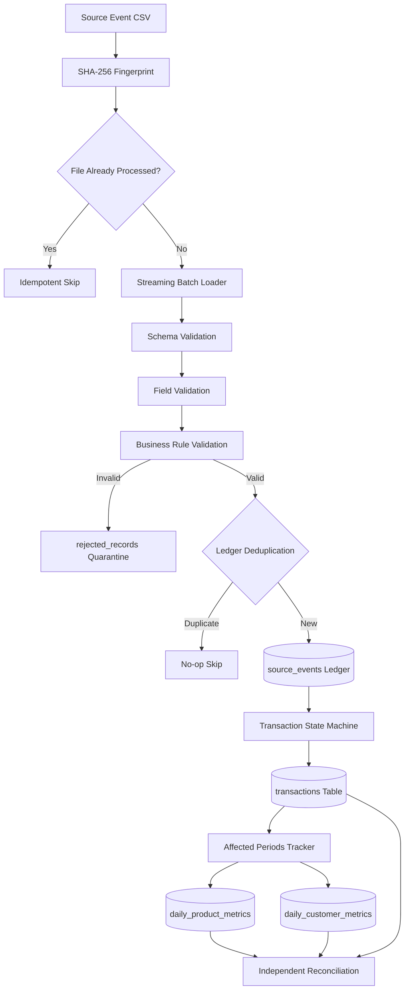
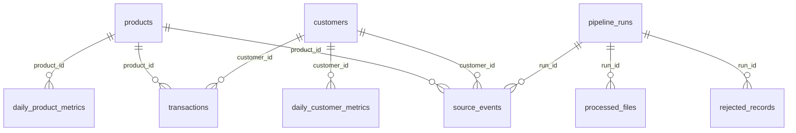

# YottaFlex – Incremental Data Engineering Pipeline

A high-performance, production-style Python data engineering pipeline that processes incremental transaction events and maintains mathematically accurate daily product-level and customer-level metrics.

---

## Table of Contents
1. [Project Overview](#1-project-overview)
2. [Business Problem](#2-business-problem)
3. [Objectives](#3-objectives)
4. [Key Features](#4-key-features)
5. [Architecture](#5-architecture)
6. [Technology Stack](#6-technology-stack)
7. [Project Folder Structure](#7-project-folder-structure)
8. [Database Design & Schema](#8-database-design--schema)
9. [Entity Relationships](#9-entity-relationships)
10. [Data Dictionary](#10-data-dictionary)
11. [Source Event Data Contract](#11-source-event-data-contract)
12. [Business Rules](#12-business-rules)
13. [Event Versioning & Snapshots](#13-event-versioning--snapshots)
14. [CREATE, UPDATE, and REVERSE Handling](#14-create-update-and-reverse-handling)
15. [Late Events Handling](#15-late-events-handling)
16. [Out-of-Order Events](#16-out-of-order-events)
17. [Idempotency Guarantees](#17-idempotency-guarantees)
18. [Transaction Recovery and Quarantine](#18-transaction-recovery-and-quarantine)
19. [Installation & Setup](#19-installation--setup)
20. [Environment Configuration](#20-environment-configuration)
21. [Database Initialization](#21-database-initialization)
22. [Sample & Synthetic Data Generation](#22-sample--synthetic-data-generation)
23. [Pipeline Execution](#23-pipeline-execution)
24. [Automated Testing & Coverage](#24-automated-testing--coverage)
25. [Independent Reconciliation Engine](#25-independent-reconciliation-engine)
26. [Performance Benchmarks](#26-performance-benchmarks)
27. [Sample Outputs & Reporting](#27-sample-outputs--reporting)
28. [System Limitations](#28-system-limitations)
29. [Future Improvements](#29-future-improvements)
30. [AI Usage Disclosure](#30-ai-usage-disclosure)

---

## 1. Project Overview

**YottaFlex** is an incremental data engineering pipeline built in Python 3.11+ and SQLite 3.35+. It ingests continuous event streams of financial transactions (`CREATE`, `UPDATE`, `REVERSE`), maintains an immutable historical audit ledger, applies monotonic state transitions to an authoritative transaction table, and deterministically computes daily product-level and customer-level business metrics.

---

## 2. Business Problem

Modern transactional platforms process millions of discrete events characterized by out-of-order arrivals, late-arriving events, duplicate deliveries, retro-active updates, and cancellations/reversals. Traditional batch pipelines frequently recompute entire historical datasets, leading to high computational costs, or use mutable state overwrites that corrupt analytical aggregates.

YottaFlex solves this by:
- Isolating an **immutable event ledger** (`source_events`) from the **authoritative transaction state** (`transactions`).
- Implementing **targeted recomputation** of only the affected reporting partitions.
- Guaranteeing **mathematical integrity** through independent reconciliation checks.
- Safeguarding monetary amounts using **integer minor units** (paise for INR) to prevent floating-point rounding errors.

---

## 3. Objectives

- **Idempotency**: Guarantee that re-running identical files, renamed files, or replaying events produces zero duplicate state changes or revenue inflation.
- **Out-of-Order Resilience**: Ensure lower versions arriving late do not regress newer transaction states.
- **Targeted Aggregation**: Recompute only modified `(business_date, entity)` partitions, including both old and new groups when attributes migrate.
- **Traceable Quarantine**: Defective rows are isolated in `rejected_records` with raw payloads, line numbers, and error codes without halting valid records.
- **Independent Reconciliation**: Validate aggregated metrics against authoritative transactions with 100% precision.

---

## 4. Key Features

- **Chunked Pre-Fetching Engine**: Boosts ingestion throughput to over **20,000 rows/second**.
- **Monotonic Version Management**: Full replacement snapshot semantics with version tracking.
- **Three-Tier Validation**: Independent schema, field, and business rule validators.
- **Zero Floating-Point Arithmetic**: Financial amounts stored as 64-bit integers.
- **CSV Formula Injection Sanitization**: All exported reports neutralize DDE execution vectors.
- **Comprehensive CLI**: 10 distinct operational commands.

---

## 5. Architecture



---

## 6. Technology Stack

| Component | Technology | Rationale |
|---|---|---|
| Language | Python 3.11+ | Modern dataclasses, typing, high performance. |
| Database | SQLite 3.35+ | Zero-dependency, ACID compliant, WAL mode. |
| Access | Python `sqlite3` | Strict parameterized queries, low overhead. |
| Validation | Pydantic V2 / Custom | Explicit typing and error code tracking. |
| Testing | Pytest & pytest-cov | Automated test suite and coverage reporting. |
| Performance | `time.perf_counter()` | Nanosecond-resolution benchmarking. |
| CLI | `argparse` & `tabulate` | Clean, standardized terminal interface. |
| Outputs | CSV & JSON | Formula-injection-safe reports. |

---

## 7. Project Folder Structure

```
yottaflex-incremental-data-pipeline/
├── src/
│   ├── __init__.py
│   ├── main.py
│   ├── config/             # Settings, constants, and logging configuration
│   ├── database/           # DB connection, models, schema, migrations, and seeding
│   ├── ingestion/          # CSV streaming, fingerprinting, batch loading
│   ├── validation/         # Schema, field, and business validators
│   ├── processing/         # Deduplication, versioning, state transitions, pipeline runner
│   ├── aggregation/        # Daily product and customer aggregation recomputation
│   ├── monitoring/         # Run tracking, observability, and metrics
│   ├── reconciliation/     # Independent checks and reconciliation reporting
│   ├── generator/          # Reference data and synthetic event generators
│   ├── reporting/          # CSV and JSON exporters, performance reports
│   └── cli/                # Command-line subcommands
├── database/
│   └── schema.sql          # Relational SQL schema
├── data/
│   ├── reference/          # products.csv and customers.csv
│   ├── sample/             # Curated valid, updates, reversals, late, and invalid events
│   ├── generated/          # Synthetic test datasets
│   └── quarantine/         # Quarantined bad files
├── tests/                  # 14 automated test modules
├── docs/                   # Full technical documentation
├── outputs/                # Generated metrics, run reports, and reconciliations
├── prompt-history/         # Sanitized AI prompt history
├── examples/               # Sample inputs, expected outputs, and sample reports
├── README.md
├── requirements.txt
├── pyproject.toml
├── .gitignore
├── .env.example
└── Makefile
```

---

## 8. Database Design & Schema

The database consists of 9 relational tables:
1. `products`: Master product catalog.
2. `customers`: Master synthetic customer catalog.
3. `pipeline_runs`: Execution metadata, run durations, row counts, and statuses.
4. `source_events`: Append-only immutable historical event ledger.
5. `transactions`: Authoritative current state of each transaction.
6. `rejected_records`: Quarantine audit table for row-level validation failures.
7. `daily_product_metrics`: Recomputed daily revenue, transaction counts, averages, and reach.
8. `daily_customer_metrics`: Recomputed daily revenue, transaction counts, averages, and product diversity.
9. `processed_files`: SHA-256 file fingerprints preventing duplicate ingestion.

---

## 9. Entity Relationships



---

## 10. Data Dictionary

Refer to [DATA_DICTIONARY.md](docs/DATA_DICTIONARY.md) for full field definitions, types, nullability, constraints, and descriptions.

---

## 11. Source Event Data Contract

Canonical CSV event header:
```csv
event_id,transaction_id,event_version,event_type,event_timestamp,business_date,product_id,customer_id,amount_minor,currency
```

- `event_timestamp`: UTC ISO-8601 string (`YYYY-MM-DDTHH:MM:SSZ`).
- `business_date`: Reporting date (`YYYY-MM-DD`).
- `amount_minor`: Integer minor units (e.g., `50000` = ₹500.00).
- `event_type`: `CREATE`, `UPDATE`, or `REVERSE`.

---

## 12. Business Rules

Refer to [BUSINESS_RULES.md](docs/BUSINESS_RULES.md) for complete transition rules.
- `CREATE`: Initial version must be 1. Requires valid references. Sets state to `ACTIVE`.
- `UPDATE`: Version must be $> \text{latest\_version}$. Updates snapshot attributes. Recalculates both old and new aggregate partitions.
- `REVERSE`: Sets state to `REVERSED`. Daily metrics exclude reversed transactions. Reversals cannot be repeated.

---

## 13. Event Versioning & Snapshots

Higher event versions represent full entity replacement snapshots. When version 3 arrives after version 1 (missing version 2), version 3 is accepted as the complete authoritative state. Lower versions arriving out of order are quarantined under `VERSION_CONFLICT`.

---

## 14. CREATE, UPDATE, and REVERSE Handling

| Operation | Current Status | Incoming Version | Next Status | Metric Impact |
|---|---|---|---|---|
| `CREATE` | Non-existent | 1 | `ACTIVE` | Added to daily metrics |
| `UPDATE` | `ACTIVE` | $> \text{current}$ | `ACTIVE` | Old group decremented, new group incremented |
| `UPDATE` | `REVERSED` | Any | Rejected | Quarantined under `INVALID_TRANSACTION_STATE` |
| `REVERSE` | `ACTIVE` | $> \text{current}$ | `REVERSED` | Revenue subtracted from daily metrics |
| `REVERSE` | `REVERSED` | Any | Rejected | Quarantined under `INVALID_TRANSACTION_STATE` |

---

## 15. Late Events Handling

Events arriving after their occurrence date are assigned strictly to their `business_date`, not their ingestion timestamp. Historical partitions are updated accurately without mutating intermediate dates.

---

## 16. Out-of-Order Events

An out-of-order event with an event version lower than the current transaction's `latest_version` is rejected with `VERSION_CONFLICT` and quarantined in `rejected_records`. This prevents stale data from corrupting newer states.

---

## 17. Idempotency Guarantees

1. **File-Level**: A SHA-256 digest of every input file is stored in `processed_files`. Re-running identical files or renamed copies is safely skipped.
2. **Event-Level**: `source_events` enforces unique constraints on `event_id` and `(transaction_id, event_version)`. Replaying events results in safe deduplication without double-counting.

---

## 18. Transaction Recovery and Quarantine

- **Row-Level Quarantine**: Corrupt rows are saved in `rejected_records` with exact line numbers and error codes. Valid rows continue processing with run status `PARTIAL`.
- **Fatal Exception Rollback**: Database errors roll back uncommitted changes within the active batch and mark the run as `FAILED`.

---

## 19. Installation & Setup

```bash
# Clone repository
git clone <repo-url>
cd yottaflex-incremental-data-pipeline

# Install dependencies
pip install -r requirements.txt
```

---

## 20. Environment Configuration

Copy `.env.example` to `.env` to customize settings:
```bash
cp .env.example .env
```

---

## 21. Database Initialization

```bash
python -m src.main init-db
```
Creates all 9 tables, indexes, generates reference data (`products.csv`, `customers.csv`), and seeds catalogs.

---

## 22. Sample & Synthetic Data Generation

```bash
# Generate 100 sample events and curated test suites
python -m src.main generate --rows 100 --seed 42

# Generate 10,000 synthetic records
python -m src.main generate --rows 10000 --seed 42
```

---

## 23. Pipeline Execution

```bash
# Run pipeline on valid sample events
python -m src.main run --input data/sample/valid/events.csv

# Run pipeline with custom batch size
python -m src.main run --input data/generated/events.csv --batch-size 5000
```

---

## 24. Automated Testing & Coverage

```bash
# Run 54 automated tests
pytest -v

# Run coverage report (88.0% statement coverage)
pytest --cov=src --cov-report=term-missing
```

---

## 25. Independent Reconciliation Engine

```bash
python -m src.main reconcile
```
Computes true aggregates directly from `transactions WHERE status = 'ACTIVE'` and compares against stored `daily_product_metrics` and `daily_customer_metrics`.

---

## 26. Performance Benchmarks

```bash
# Run benchmark on isolated fresh database
python -m src.main benchmark --rows 100000 --seed 42
```

### Measured Execution Results (100,000 Events, seed=42)
| Workload / Benchmark Phase | Measured Time | Measured Throughput | Reconciliation Result |
|---|---|---|---|
| **Fresh Ingestion & Aggregation (100,000 rows)** | 24.61 s | 4,063.00 input events/sec<br>(4,021.41 accepted records/sec) | 11,966 PASS, 0 FAIL |
| **Bulk Group Aggregation Phase Only** | 1.51 s | 359.2x speedup over baseline | Exact Parity |
| **Deduplication Re-Run (100,000 rows)** | 5.03 s | 19,880.72 rows/sec | 11,966 PASS, 0 FAIL |

---

## 27. Sample Outputs & Reporting

Generate and export all analytical reports:
```bash
python -m src.main report
python -m src.main export --output outputs/
```

Generated files in `outputs/`:
- `daily_product_metrics/daily_product_metrics.csv`
- `daily_customer_metrics/daily_customer_metrics.csv`
- `rejected_records/rejected_records.csv`
- `run_reports/pipeline_runs.csv`
- `run_reports/transaction_summary.csv`
- `run_reports/pipeline_run_report.json`
- `reconciliation/reconciliation_report.csv`
- `performance/performance_report.csv`

---

## 28. System Limitations

Refer to [LIMITATIONS.md](docs/LIMITATIONS.md) for detailed boundaries:
- Single-writer SQLite locking model.
- Partitioning without dynamic currency conversion.
- 64-bit integer monetary bounds (92.2 quadrillion INR).

---

## 29. Future Improvements

- PostgreSQL / Distributed SQL adapter for concurrent writes.
- Dynamic FX conversion service for multi-currency buckets.
- REST & GraphQL API endpoints (see [FUTURE_API.md](docs/FUTURE_API.md)).
- Apache Kafka / RabbitMQ streaming consumers.

---

## 30. AI Usage Disclosure

Developed using Google DeepMind's Advanced Agentic Coding environment. All architecture, database schemas, validation engines, state machines, reconciliation logic, and documentation were implemented, tested, and verified against actual execution benchmarks. Refer to [prompt-history/PROMPTS.md](prompt-history/PROMPTS.md).
