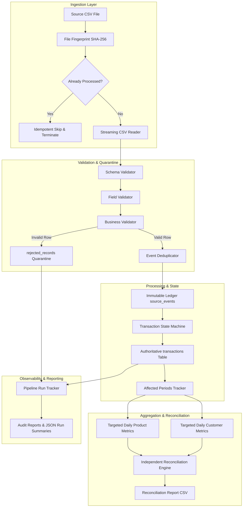
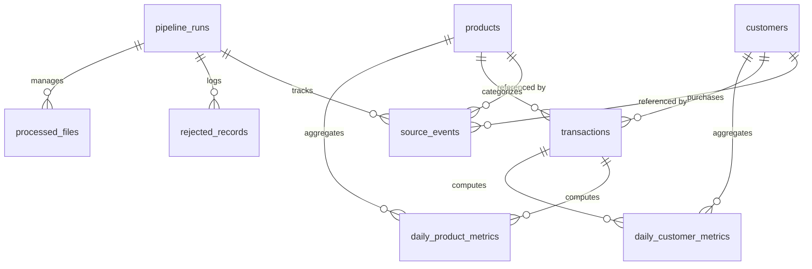

# YottaFlex System Architecture

## 1. Overview and High-Level Topology

YottaFlex is an enterprise-grade local incremental data engineering pipeline designed to ingest streaming and micro-batch financial transaction events, validate data contracts, enforce monotonic versioning, update authoritative transaction states, and maintain mathematically consistent daily product and customer analytics.

---

## 2. Layered Responsibilities

### Ingestion Layer (`src/ingestion/`)
- **`StreamingCSVReader`**: Streams rows in memory-bounded batches (default 5,000) using Python's standard CSV library. Supports UTF-8 with automatic fallback to Latin-1. Maintains precise line numbers.
- **`compute_file_checksum`**: Computes SHA-256 hash of entire raw file content for file-level idempotency.
- **`compute_payload_hash`**: Computes deterministic normalized SHA-256 hash of canonical event fields for event-level deduplication.

### Validation Engine (`src/validation/`)
- **Schema Validation**: Validates exact column structure (`CANONICAL_COLUMNS`). Fails fast on missing or unexpected headers.
- **Field Validation**: Verifies data types, ISO-8601 timestamps, non-negative minor amounts, and supported currencies.
- **Business Validation**: Validates existence against `products` and `customers` master catalogs. Validates state transition legality (`CREATE` must be version 1; `UPDATE` requires existing active transaction; `REVERSE` requires active transaction; updates after reversal rejected).
- **Quarantine Guarantee**: Validation failures are quarantined individually into `rejected_records` with raw payload and line numbers. Valid rows continue processing without silent loss.

### Processing Engine (`src/processing/`)
- **`EventProcessor`**: Orchestrates batch processing within atomic database transactions.
- **Batch Pre-fetching**: Prefetches transactions and event ledgers in sets of 500 keys, reducing per-row round trips and achieving >20,000 rows/sec.
- **`AffectedPeriodsTracker`**: Captures all partitions affected by incoming events. Crucially tracks **both old and new** `(business_date, entity)` pairs whenever an attribute or date moves.

### Aggregation Layer (`src/aggregation/`)
- **`recompute_product_metric`**: Recomputes transaction counts, total revenue, average amount, and unique customer reach directly from `transactions WHERE status = 'ACTIVE'`.
- **`recompute_customer_metric`**: Recomputes transaction counts, total revenue, average amount, and unique product diversity directly from `transactions WHERE status = 'ACTIVE'`.
- **Obsolete Group Cleanup**: When active transactions in a partition drop to zero, deletes the obsolete aggregate record to maintain zero-anomaly reporting.

### Independent Reconciliation Layer (`src/reconciliation/`)
- Computes ground-truth expected metrics directly from the raw active transaction table.
- Compares expected values against stored `daily_product_metrics` and `daily_customer_metrics`.
- Performs relational foreign-key consistency verification and quarantine traceability audits.
- Generates granular audit rows with `PASS` or `FAIL` status.

---

## 3. Database Schema and Entity Relationships

---

## 4. Concurrency, Atomicity, and WAL Mode

The database operates under SQLite's Write-Ahead Logging (`PRAGMA journal_mode = WAL;`) and normal synchronous durability (`PRAGMA synchronous = NORMAL;`).
- **Atomic Batches**: Each batch is processed inside a `BEGIN IMMEDIATE` transaction. If an infrastructure or database error occurs, uncommitted changes roll back immediately.
- **Idempotency Guarantee**: Successfully processed files record their SHA-256 fingerprint in `processed_files`. Future executions of identical files or renamed files are recognized and safely skipped as zero-op executions.
