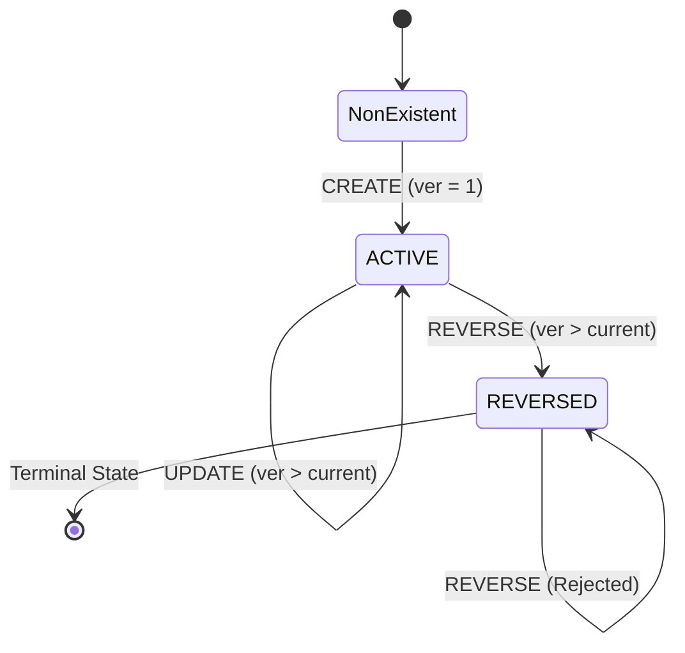

# YottaFlex Business Rules and Processing Specifications

This document defines the formal business rules, state transitions, validation logic, and event handling semantics governing the YottaFlex Incremental Data Pipeline.

---

## 1. Event Types and State Lifecycle

The pipeline operates on three canonical event types: `CREATE`, `UPDATE`, and `REVERSE`.

### 1.1 CREATE Rules
1. **Creation Constraint**: A transaction must not already exist in the `transactions` table. Attempting to create an existing transaction results in `INVALID_TRANSACTION_STATE`.
2. **Initial Version**: The event version must strictly equal `1`. A `CREATE` event with version $\ge 2$ is rejected with `VERSION_CONFLICT`.
3. **Foreign Key Integrity**: The `product_id` must exist in `products`, and `customer_id` must exist in `customers`. Unregistered foreign keys result in `UNKNOWN_PRODUCT` or `UNKNOWN_CUSTOMER`.
4. **Financial Unit**: `amount_minor` must be an integer $\ge 0$. Negative values are prohibited (`INVALID_AMOUNT`).
5. **Initial State**: Transitions transaction status directly to `ACTIVE`.

### 1.2 UPDATE Rules
1. **Existence Requirement**: The referenced `transaction_id` must exist in `transactions`. Updating a non-existent transaction is rejected with `INVALID_TRANSACTION_STATE`.
2. **Terminal State Immutability**: If a transaction has status `REVERSED`, any subsequent `UPDATE` is strictly rejected with `INVALID_TRANSACTION_STATE`. Reversals are terminal.
3. **Monotonic Versioning**: The incoming `event_version` must be strictly greater than `latest_version`. If $\le \text{latest\_version}$, it is rejected as `VERSION_CONFLICT` (or safely ignored if exact duplicate).
4. **Complete Replacement Snapshot**: An update replaces all mutable fields (`product_id`, `customer_id`, `business_date`, `amount_minor`).
5. **Multi-Partition Impact**: When an `UPDATE` modifies `business_date`, `product_id`, or `customer_id`, both the **old group** and the **new group** must be recomputed to prevent orphaned metrics.

### 1.3 REVERSE Rules
1. **Existence Requirement**: The referenced `transaction_id` must already exist.
2. **Active Status Requirement**: The current transaction status must be `ACTIVE`. If already `REVERSED`, the event is rejected with `INVALID_TRANSACTION_STATE`. Reversals cannot be applied twice.
3. **Revenue Exclusion**: Reversal transitions the transaction status to `REVERSED`. Daily product and customer aggregations strictly select `WHERE status = 'ACTIVE'`, thereby subtracting the transaction's revenue contribution.
4. **Ledger Preservation**: The reversal event is permanently stored in `source_events` to preserve an immutable audit trail.
5. **Obsolete Group Cleanup**: If a reversal removes the final active transaction in a `(business_date, entity)` partition, the aggregate record is automatically deleted from `daily_product_metrics` or `daily_customer_metrics`.

---

## 2. Event Versioning and Out-of-Order Delivery

### 2.1 Deduplication
- **Exact Duplicate**: If an incoming event matches an existing record in `source_events` by `event_id` or `(transaction_id, event_version)` with identical payload hash, it is safely treated as an idempotent no-op. Duplicate count is incremented, and no state or aggregate changes are made.
- **Conflicting Duplicate**: If an event arrives with an existing `event_id` or `(transaction_id, event_version)` but has a different payload hash, it is quarantined in `rejected_records` under `DUPLICATE_EVENT`.

### 2.2 Late-Arriving Events
- Events must contribute strictly to their own `business_date`, regardless of the calendar date or timestamp when the pipeline ingests them.
- If a late `CREATE` arrives with a historical `business_date` (e.g., 20 days ago), that historical business date partition is dynamically recomputed without affecting intervening dates.
- Out-of-order lower versions ($v_{\text{incoming}} < v_{\text{latest}}$) arriving after a newer snapshot has already been accepted are rejected with `VERSION_CONFLICT` to protect against state regression.

---

## 3. Rejection Codes

| Code | Trigger Condition |
|---|---|
| `MISSING_REQUIRED_FIELD` | Mandatory column is empty or missing from row. |
| `INVALID_AMOUNT` | Amount is negative, non-numeric, or fractional. |
| `INVALID_TIMESTAMP` | Timestamp is not valid ISO-8601 or date is not `YYYY-MM-DD`. |
| `INVALID_EVENT_TYPE` | Event type is not `CREATE`, `UPDATE`, or `REVERSE`. |
| `UNKNOWN_PRODUCT` | Referenced `product_id` does not exist in `products`. |
| `UNKNOWN_CUSTOMER` | Referenced `customer_id` does not exist in `customers`. |
| `INVALID_TRANSACTION_STATE` | Creating duplicate txn, updating non-existent txn, updating reversed txn, or repeated reversal. |
| `VERSION_CONFLICT` | Version sequence violation (e.g. CREATE with ver > 1, or late lower version). |
| `DUPLICATE_EVENT` | Duplicate event ID or transaction version with conflicting payload. |
| `SCHEMA_MISMATCH` | CSV header contains missing or unexpected columns. |
